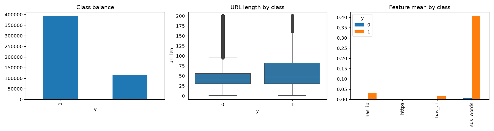
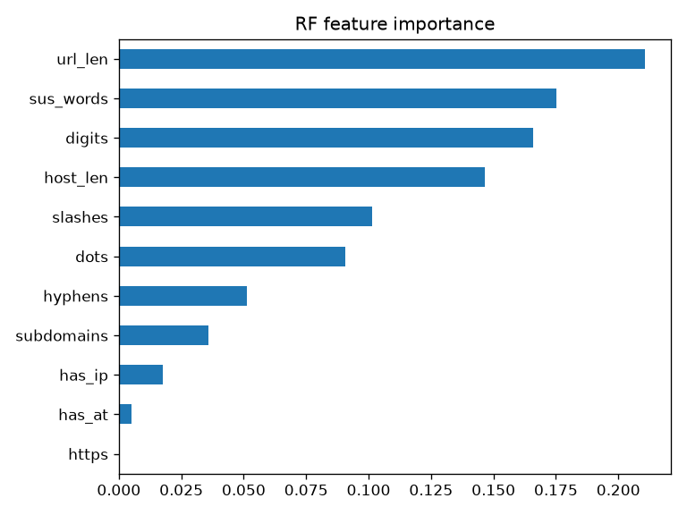

# Phishing URL Classifier

A machine learning model that predicts whether a URL is phishing or legitimate using
only the URL text, without visiting the site.

## Dataset

[Phishing Site URLs](https://www.kaggle.com/datasets/taruntiwarihp/phishing-site-urls) from Kaggle: 549,346 URLs labeled `good`
or `bad`. After removing exact duplicates, 507,195 URLs remain (roughly 77% good,23% phishing). The data and trained model are not included in this repo because of their size.

## Approach

1. Removed duplicate URLs before splitting, so the same URL can't be in both train and test.
2. Extracted 11 features from each URL: length, host length, dots, hyphens, `@`, IP in
   host, https, subdomains, digits, slashes, and a count of suspicious words
   (login, verify, bank, secure, account, update, signin, paypal).
3. Stratified 80/20 train/test split (`random_state=42`).
4. Trained 4 models and compared them with accuracy, precision, recall, F1 and
   5-fold cross-validated F1.

## Results (held-out test set, 101,439 URLs)

| Model | Accuracy | Precision | Recall | F1 | CV F1 |
|---|---|---|---|---|---|
| Random Forest | 0.9091 | 0.8460 | 0.7292 | 0.7833 | 0.7797 |
| XGBoost | 0.9048 | 0.8682 | 0.6811 | 0.7633 | 0.7633 |
| Decision Tree | 0.8723 | 0.8261 | 0.5487 | 0.6594 | 0.6631 |
| Logistic Regression | 0.8515 | 0.8996 | 0.3841 | 0.5383 | 0.5397 |

Random Forest confusion matrix:

| | Predicted good | Predicted phishing |
|---|---|---|
| **Actually good** | 75,545 | 3,034 |
| **Actually phishing** | 6,191 | 16,669 |




## Key findings

- **Accuracy is misleading on imbalanced data.** Logistic Regression has 85% accuracy
  but catches only 38% of phishing URLs.
- **Tree-based models win** because the signals don't combine in a straight line.
- **Top features:** `url_len`, `sus_words`, `digits`, `host_len`. `https` is almost
  always 0 in this dataset, so it contributes nothing.
- **Recall matters more than precision here.** A missed phishing URL can lead to stolen
  credentials, while a false alarm only annoys the user. The best model still misses
  27% of phishing URLs.
- **What the missed phishing URLs look like:** short, clean-looking URLs, compromised
  legitimate sites (e.g. WordPress paths like `/wp-includes/`), and links on trusted
  file-hosting domains. URL text alone can't separate these from legitimate sites.

## Limitations

- Only URL text is used. Page content, domain age (WHOIS) and reputation data would
  help catch the hard cases.
- I removed exact duplicates only. Different URLs from the same domain can still land
  in both train and test, which may inflate scores slightly.
- The dataset has noisy rows (stray quotes, spaces), and the good and bad URLs may come
  from different sources, which could bias the model.
- Hyperparameters were not tuned, and the decision threshold is the default 0.5.

## How to run

```bash
git clone https://github.com/sonicpeak/url-classifier.git
cd url-classifier
pip install -r requirements.txt
```

1. Download the dataset from Kaggle and put `phishing_site_urls.csv` in a `data/` folder.
2. Open `notebooks/phishing.ipynb` and run the cells in order.